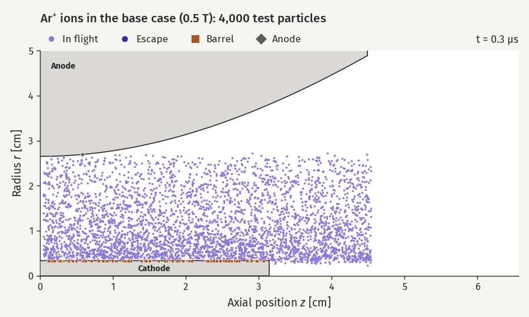

# Cathode erosion in AF-MPD thrusters

**A test-particle kinetic model and HTS magnetic shielding**

Ignacio Díaz, Gonzalo Avaria

Departamento de Física, Universidad Técnica Federico Santa María, Santiago, Chile

Poster presented at the XXV Simposio Chileno de Física (SOCHIFI 2026), Santiago, Chile, 23–26 November 2026.

## Animation

Each dot is one of 4,000 argon ions (Ar⁺) followed as a test particle in the base case (0.5 T nozzle field). An ion keeps moving until it leaves through the nozzle or hits an electrode, and then takes the color of the place where it ended. Averaged over ten independent runs, 84% of the ions escape, 9.9% hit the cathode barrel and 5.5% hit the anode.

## References

In the order in which the poster uses them.

1. Robert G. Jahn, *Physics of Electric Propulsion*. McGraw-Hill, New York (1968). Electric propulsion and its families.
2. Gerd Krülle, Monika Auweter-Kurtz and Akihiro Sasoh, "Technology and Application Aspects of Applied Field Magnetoplasmadynamic Propulsion," *Journal of Propulsion and Power* **14**(5), 754–763 (1998). What the applied field does.
3. V. B. Tikhonov et al., "Investigation on a New Type of MPD Thruster," in *27th EPS Conference on Controlled Fusion and Plasma Physics*, ECA vol. 24B, 81–84, Budapest (2000). Lifetime of 5,000 to 10,000 hours required for deep-space missions.
4. Roger M. Myers, Maris A. Mantenieks and Michael R. LaPointe, "MPD Thruster Technology," NASA TM-105242, NASA Lewis Research Center, Cleveland, OH (1991). Electrode erosion as the limit to lifetime.
5. Jinxing Zheng et al., "Integrated Study on the Comprehensive Magnetic-Field Configuration Performance in the 150 kW Superconducting Magnetoplasmadynamic Thruster," *Scientific Reports* **11**, 20706 (2021). [doi:10.1038/s41598-021-00308-4](https://doi.org/10.1038/s41598-021-00308-4). Twice the estimated cathode lifetime with a superconducting magnet.
6. Ioannis G. Mikellides, Ira Katz, Richard R. Hofer and Dan M. Goebel, "Magnetic Shielding of a Laboratory Hall Thruster. I. Theory and Validation," *Journal of Applied Physics* **115**(4), 043303 (2014). [doi:10.1063/1.4862313](https://doi.org/10.1063/1.4862313). Shielding by reshaping the plasma potential near the wall.
7. Jinxing Zheng et al., "High performance of high-temperature-superconducting MPD thrusters: analytical MHD modeling and experimental demonstration," *National Science Review* **13**, nwaf589 (2026). [doi:10.1093/nsr/nwaf589](https://doi.org/10.1093/nsr/nwaf589). Fields tested so far in thrusters with superconducting magnets.
8. S. Dushman and Jessie W. Ewald, "Electron Emission from Thoriated Tungsten," *Physical Review* **29**, 857–870 (1927). [doi:10.1103/PhysRev.29.857](https://doi.org/10.1103/PhysRev.29.857). Emission of thoriated tungsten with a full and with an incomplete thorium layer.
9. Erik Lassner and Wolf-Dieter Schubert, *Tungsten: Properties, Chemistry, Technology of the Element, Alloys, and Chemical Compounds*. Kluwer Academic / Plenum Publishers, New York (1999). Properties of tungsten.
10. Monika Auweter-Kurtz et al., "Cathode Phenomena in Plasma Thrusters," *Journal of Propulsion and Power* **9**(6), 882–888 (1993). [doi:10.2514/3.23703](https://doi.org/10.2514/3.23703). Measured tip temperatures and erosion of thoriated cathodes.
